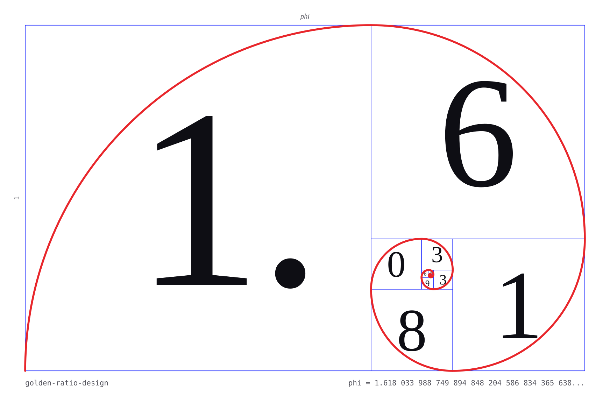
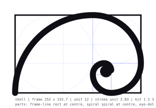
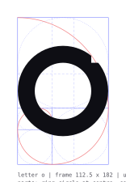
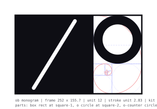
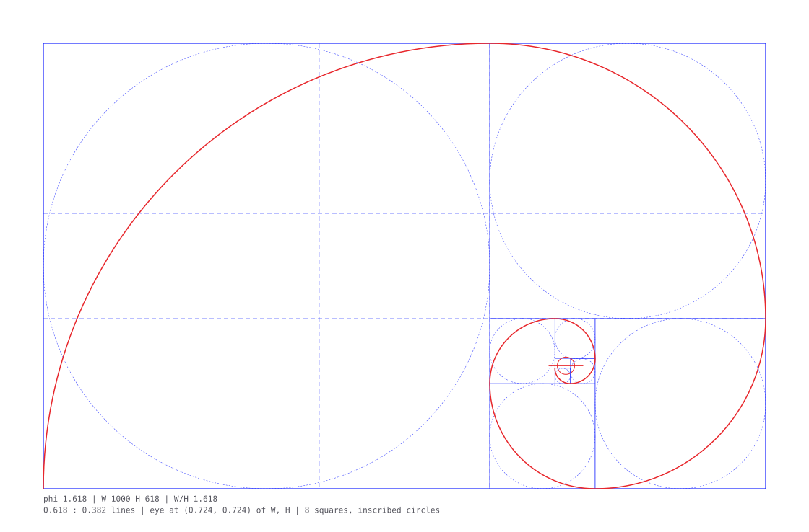
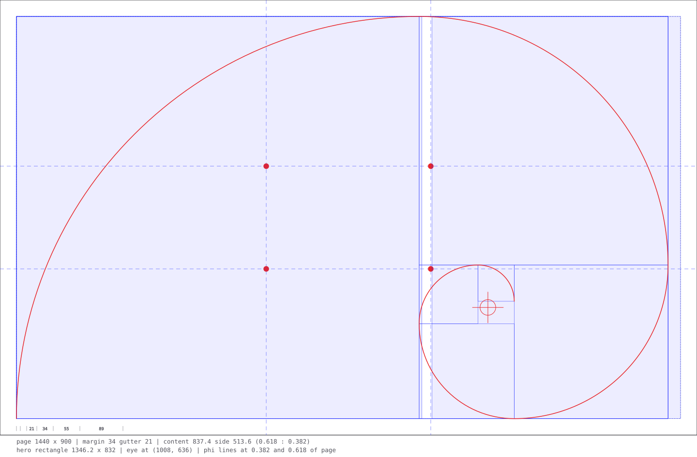

<picture>
  <source media="(prefers-color-scheme: dark)" srcset="assets/hero-dark.svg">
  
</picture>

# golden-ratio-design

Golden ratio (divine proportion) maths for design, as scripts and rules for Illustrator and Figma. One ratio, phi 1.618, drawn as grids, squares, spirals and circles for logos and icons, turned into type scales, spacing sequences and colour shares, and laid over pages and app screens. Every output is an editable template: locked construction layer, named parts, values written in the file, so a designer finishes it by hand.

It is also a skill for Claude Code: drop the folder into `.claude/skills/` and it becomes the default proportion system for design work in that project.

## The rules

1. **Measure before you draw.** Sizes, gaps, strokes, type sizes, colour areas, into a table. The check tells you what is already on the ratio.
2. **One golden rectangle frames the work.** Sides 1 : 1.618. A logo, a hero, a card, a first screen.
3. **Squares make the spiral, and the spiral places the first thing.** The eye of the spiral sits at 0.724 of the width and height. Put the focal point there or on a crossing of the 0.382 and 0.618 lines.
4. **Sizes step by phi, whole steps.** 1, 1.618, 2.618, 4.236. Spacing follows the sequence 8 13 21 34 55 89 144.
5. **Split space 61.8 / 38.2.** Three parts: 61.8 / 23.6 / 14.6. Content and sidebar, image and caption, logo and clear space.
6. **Line weights step by phi, and the inside joins them.** Hairline, regular, bold at 1, 1.618, 2.618 of the thinnest. Counters, gaps, slits and margins each take a whole step of the main stroke, up or down.
7. **Type: the body size of the chosen typeface is 1, and every level is a ratio of it.** Small text 0.618, subheads 1.618, headings 2.618 and 4.236, whole steps only. No size is set: whatever body the designer chooses, the levels follow. One typeface plus its body size is a version. Line height 1.618 for body, 1.272 for subheads, 1.0 for headings. Measure 45 to 75 characters. A display face sits at least one full step above body where they meet.
8. **Colour: dominant 61.8, secondary 23.6, accent 14.6, measured by area.** The heaviest colour takes the smaller share. A new hue sits 137.5 degrees round the wheel.
9. **Within 3 percent is on.** The eye has the final say, and every departure is written down with its reason. The sets are dense: at 3 percent an arbitrary ratio lands on 23 percent of the time with the default set and 28 with the full one, and a single whole step 1 time in 8. Weigh full steps and relations between independent parts.
10. **Leave it as a template.** Locked "Golden grid" layer, named groups, notes with the values, variables bound to one base size.
11. **A stretch changes the weights.** Letters scaled taller get heavier horizontals. Check horizontals against stems after any one-way scaling. Find the stretch where they match, and check the x-height there.
12. **No free numbers.** Every size comes from the contract's sets or is logged as a departure with a reason. The lint blocks type, line height, spacing, strokes and columns that step outside; new marks are built from a grammar that cannot.

## What is inside

| path | what |
|:---|:---|
| `scripts/golden_grid.py` | SVG grids (rectangle, squares, spiral, circles, phi lines, eye), page and phone grids, type levels as ratios of body (px only when a body is given), type versions, and spacing tables, colour shares, this README's hero image |
| `scripts/proportion_check.py` | ratio report for pairs, JSON or an SVG: on, near, off, what each side would need to be, and the chance rate; `--ladder` puts line weights, gaps and counters on one phi ladder; `--logo` does it for a logo SVG |
| `scripts/logo_measure.py` | measures a logo drawn as filled shapes: line widths per shape, gaps between ink edges, counters, parts and the gap between them, and for a wordmark the baseline, x-height, ascender, descender, stem and letter gaps; then every value on the phi ladder |
| `contract/golden.json` | the proportion contract: allowed sets per domain, block or warn, tolerance, exempt values, departures log |
| `scripts/golden_lint.py` | the enforcer: lints CSS, Figma variables, SVG or plain values against the contract; snaps; `--fix` writes a pushed copy of a CSS file (or two, step down and step up); on a logo SVG it judges the measured relations on the ladder |
| `scripts/golden_build.py` | the construction engine: a plan in the golden grammar (kit sizes, frame points, phi strokes, listed angles) becomes an SVG and an Illustrator script; anything outside the sets is refused |
| `examples/plans/` | three plans with their renders: a shell, a letter o, a two-letter monogram |
| `scripts/golden_grid.jsx` | Illustrator: the construction on a locked layer around the selection, every part named |
| `figma/` | Figma plugin: golden grid on selection, phi guides and a 21-column grid, a Golden variables collection built from the chosen body size and updated on rerun |
| `references/` | the method by area: basics, logo and icon (inside the mark included), typography, colour, website, app, Figma, handover, the source video |
| `examples/oblique.md` | a worked example with real numbers |
| `assets/grids/` | ready SVG grids: 1000 landscape, 390 portrait, 1440 by 900 page, 390 by 844 phone |
| `SKILL.md` | the Claude Code skill file |

## Quick start

Illustrator: select the artwork, then File > Scripts > Other Script and pick `scripts/golden_grid.jsx`. A locked layer "Golden grid" appears with the rectangle, squares, circles, phi lines, spiral, eye and a notes line. Or from a shell:

```bash
osascript -e 'tell application "Adobe Illustrator 2026" to do javascript (POSIX file "/path/to/scripts/golden_grid.jsx")'
```

Figma: Plugins > Development > Import plugin from manifest, choose `figma/manifest.json`. Select a frame, run "Phi guides and 21-column grid". Select artwork, run "Golden grid on selection". Run "Golden variables" once per file.

Anywhere:

```bash
python3 -I scripts/golden_grid.py page --width 1440 --height 900 --out page.svg
python3 -I scripts/golden_grid.py scale
python3 -I scripts/golden_grid.py scale --body <body size> --format css
python3 -I scripts/golden_grid.py version --contract my.golden.json --typeface "Name" --body <body size>
python3 -I scripts/golden_grid.py shares --parts 3
python3 -I scripts/proportion_check.py --pairs "hero=1440/890" "label/body=11/18" --tolerance 3
python3 -I scripts/proportion_check.py --ladder "line=19.55" "gap=31.6" "counter=51.2" "stem=82.8" --unit stem
python3 -I scripts/logo_measure.py logo.svg
python3 -I scripts/golden_lint.py --svg logo.svg
python3 -I scripts/golden_lint.py --css styles.css --contract contract/golden.json
python3 -I scripts/golden_lint.py --css styles.css --body <body size>
python3 -I scripts/golden_lint.py --snap 23 --domain space
python3 -I scripts/golden_build.py examples/plans/monogram.json --out monogram.svg --jsx monogram.jsx
```

## Enforcing it

The contract names the values that exist. The lint reads a stylesheet, a Figma variables export or an SVG and reports every proportion-bearing value as on, near, exempt, logged, off or unchecked (em and fr need their context), with the step below and above it. Off values in type, line height, spacing, strokes and columns fail the run. Type is judged as ratios of the contract's body: a size 1.618 times the body reports as a subhead, and one between levels names the two it falls between. For a CSS file, `--fix` writes a copy with them pushed to the step, or two copies (down and up) to choose between; Figma and SVG inputs are reported only. The original file is never edited.

A logo exported as filled shapes has no stroke-width to read, so the lint measures it with `logo_measure.py`. Five relations go on the phi ladder: the icon's line over the wordmark stem, the icon's gap over its line, x-height over stem, icon height over x-height, and the gap between icon and wordmark over the stem. An off relation blocks like an off type size, until it is fixed or logged in the contract's departures with its relation and a reason.

## Building a mark from it

An agent writes a plan: sizes from the kit (1 2 3 5 8 13 21), positions on the frame's points (the eye, the phi crossings, the squares), strokes by phi step, angles from the list. The engine refuses any other number unless it carries a reason, then renders the SVG and an Illustrator script that puts the construction on its own layer under the locked grid.

| | | |
|:---:|:---:|:---:|
|  |  |  |
| `shell.json` | `letter-o.json` | `monogram.json` |

## The numbers

| value | meaning |
|---:|:---|
| 1.618 | phi, the bigger part over the smaller |
| 0.618 | the bigger part's share of the whole |
| 0.382 | the smaller part's share |
| 0.236 and 0.146 | the smaller part split again, for a third and fourth share |
| 1.272 | the square root of phi: the subhead line height |
| 0.724 | the spiral's eye, as a fraction of width and height (0.276 of width when portrait) |
| 137.5 degrees | the golden angle |
| 1 1 2 3 5 8 13 21 34 55 89 144 | the sequence: the ratio in whole numbers |

## Grids

| | |
|:---:|:---:|
|  |  |
| golden rectangle with squares, spiral, circles, phi lines | page grid with phi lines, golden columns, hero rectangle, spacing ruler |

## Version 3 (2026-10-22)

The type rule has no sizes. The body size of the chosen typeface is 1 and every level is a ratio of it: small 0.618, body 1, subhead 1.618, heading 2 2.618, heading 1 4.236, whole steps only. The default contract sets no typeface and no size; a project records its choice with `golden_grid.py version`, and each change of typeface or body size is a new version with a repo tag. `golden_grid.py scale` prints the ratios and adds px only when given a body, and its CSS tokens derive from `--type-body`. The lint judges every font size as a ratio of the contract's body (or `--body N`) and leaves type unchecked when no body is set. The Figma plugin builds the type levels from the selected text layer or the collection's `type/body`. Version 2 contracts (`hero`) and version 1 contracts (`base`) still load.

## Sources

- The Futur Academy, "How To Draw And Use Fibonacci Grid In Your Design Layout" (2020). Its chapters are listed in `references/09-video-notes.md`; the method is still to be transcribed: https://www.youtube.com/watch?v=n6BsmS68uAo
- Robert Bringhurst, *The Elements of Typographic Style*, for the 45 to 75 character measure.
- The near-miss audit list (stroke weights, radii, angles, concentric circles, symmetry) follows the construction-grid tools Logo Grid Lines by Studio Gibbous and LogoGrid.

## Licence

MIT. Fonts, logos and brands named in the examples belong to their owners.
